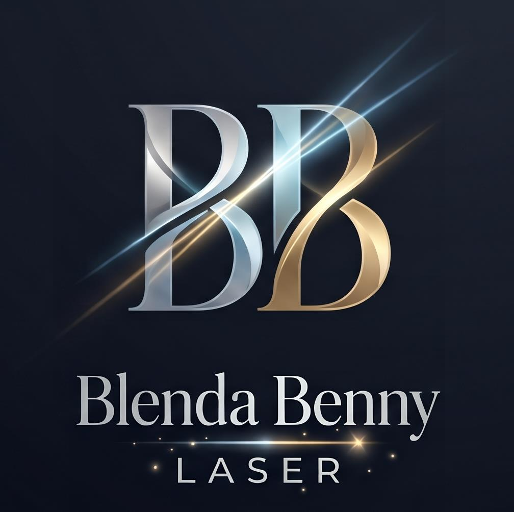
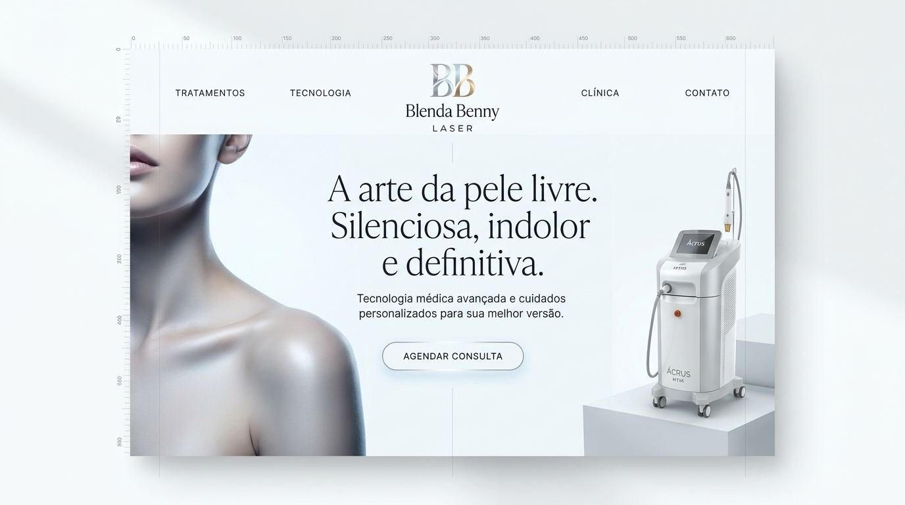
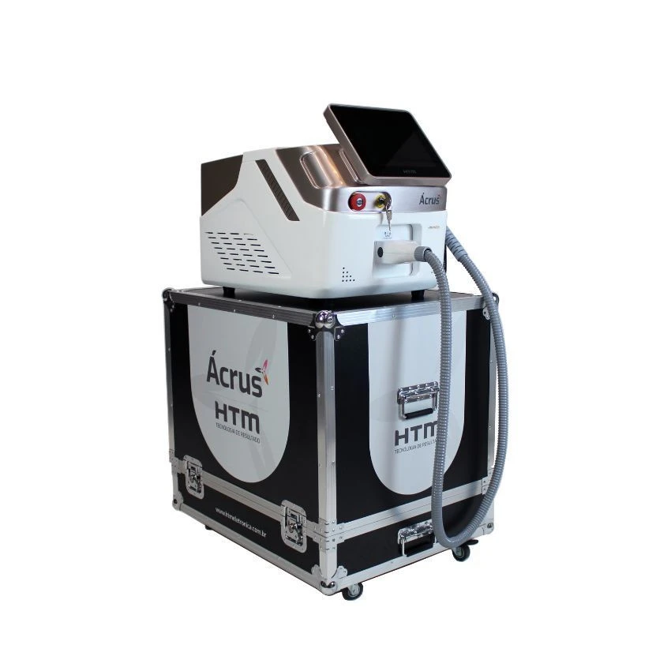

<div align="center">



# ✨ Blenda Benny — Depilação a Laser & Estética

**Landing Page Oficial • Tecnologia Ácrus HTM Tripla Onda (até -10°C) & Botox (Toxina Botulínica)**

[](https://blenda-benny-laser.vercel.app)
[_99138--5422-1B2845?style=for-the-badge)](https://wa.me/5534991385422)
[](https://www.instagram.com/blebsp/)

</div>

---

## 🔗 Acesso Rápido

| Recurso | Link Direto |
| :--- | :--- |
| 🌐 **Site Oficial (No Ar)** | **[https://blenda-benny-laser.vercel.app](https://blenda-benny-laser.vercel.app)** |
| 📄 **Código da Página Principal** | [`index.html`](./index.html) |
| 🖼️ **Pasta de Imagens e Ativos** | [`assets/`](./assets/) |
| 📱 **WhatsApp de Agendamento** | [**(34) 99138-5422**](https://wa.me/5534991385422) |
| 📸 **Instagram Oficial** | [**@blebsp**](https://www.instagram.com/blebsp/) |

---

## 🖼️ Vitrine Visual do Projeto

<div align="center">
  
</div>

<br />

| Logomarca Oficial (`BB`) | Equipamento Oficial (`Ácrus HTM`) | Estética Facial (`Botox`) |
| :---: | :---: | :---: |
|  |  |  |
| [`assets/logo-crop.jpg`](./assets/logo-crop.jpg) | [`assets/acrus-oficial.webp`](./assets/acrus-oficial.webp) | [`assets/botox-editorial.jpg`](./assets/botox-editorial.jpg) |

---

## ⚡ Sobre o Equipamento: Ácrus HTM (Aplicador Tripla Onda)

Informações oficiais conferidas diretamente na **HTM Eletrônica** e explicadas de forma simples e acessível para os clientes:

* **Ponteira Super-Resfriada até -10°C (*Cryocooling MAXX*):** A ponteira fica gelada durante toda a aplicação, protegendo a pele e diminuindo a sensação de calor para um atendimento praticamente sem dor.
* **3 Lasers no Mesmo Disparo (*Tripla Onda*):** Une simultaneamente **Alexandrite (755nm)**, **Diodo (808nm)** e **Nd:YAG (1064nm)** — alcançando desde os pelos mais finos até os mais grossos e profundos de uma só vez.
* **Seguro para Todos os Tons de Pele:** Atende com total segurança peles claras, morenas e negras.
* **Atendimento Itinerante:** A cada dia a **Blenda Benny** leva o equipamento para uma clínica, salão ou estúdio parceiro diferente, atendendo com hora marcada.

---

## 📋 Áreas de Atendimento Cadastradas no Site

O site conta com um **Seletor Interativo** onde a cliente (ou o cliente) clica nas áreas desejadas e envia a mensagem pronta para o WhatsApp da Blenda:

### 1. Depilação a Laser — Feminino (14 Áreas)
* **Facial & Membros Superiores:** `Rosto` • `Buço` • `Axilas` • `Braços`
* **Tronco & Linha Corporal:** `Seios` • `Barriga` • `Linha alba` • `Costas`
* **Íntimo, Glúteos & Pernas:** `Virilha simples` • `Virilha completa` • `Glúteos` • `Coxas` • `Meia perna` • `Pernas inteiras`

### 2. Depilação a Laser — Masculino (13 Áreas)
* **Barba, Maxilar & Face:** `Barba` • `Contorno de Barba` • `Maxilar` • `Orelha`
* **Tronco, Costas & Braços:** `Peito` • `Barriga` • `Costas` • `Braços`
* **Íntimo, Glúteos & Pernas:** `Virilha simples` • `Virilha completa` • `Glúteos` • `Meia perna` • `Pernas inteiras`

### 3. Botox — Toxina Botulínica (Facial & Terapêutico)
* **Testa & Área dos Olhos:** Linhas da Testa • Entre as Sobrancelhas (Glabela) • Pés de Galinha
* **Botox Preventivo:** Aplicação suave para prevenir rugas mantendo a expressão 100% natural
* **Pescoço, Sorriso & Bruxismo:** Contorno do Rosto e Pescoço • Sorriso Gengival • Queixo • Bruxismo
* **Rosto Completo & Controle do Suor:** Rejuvenescimento facial global ou controle de suor excessivo (Axilas e Mãos)

---

## 📂 Estrutura de Pastas (Fácil de Achar Tudo)

```text
📦 blenda-benny-laser
 ┣ 📄 index.html                      # Código completo do site (HTML5 + Tailwind CSS + JS Interativo)
 ┣ 📄 README.md                       # Documentação visual e guia rápido do repositório
 ┣ 📁 assets/                         # Pasta com todas as fotos e logomarcas otimizadas do site
 ┃ ┣ 🖼️ acrus-oficial.webp            # Foto oficial do aparelho Ácrus HTM com a maleta móvel
 ┃ ┣ 🖼️ logo-crop.jpg                 # Logomarca oficial recortada (Monograma BB Blenda Benny)
 ┃ ┣ 🖼️ logo-blenda-benny.jpg         # Logomarca original completa em alta resolução
 ┃ ┣ 🖼️ hero-skin.jpg                 # Fotografia principal da primeira dobra (Hero Section)
 ┃ ┣ 🖼️ botox-editorial.jpg           # Fotografia da seção de Botox (Toxina Botulínica)
 ┃ ┣ 🖼️ mockup-ui-blenda-benny.jpg    # Mockup 16:9 de apresentação do layout
 ┃ ┗ 🖼️ flyer-acrus-htm.jpeg          # Arte original de referência com o contato da clínica
 ┗ 📄 acrus-laser-de-ep-03_1_jpg.webp # Arquivo original da foto oficial do equipamento Ácrus HTM
```

---

## 🚀 Como Visualizar ou Editar

1. **Ver Online:** Basta acessar **[https://blenda-benny-laser.vercel.app](https://blenda-benny-laser.vercel.app)**.
2. **Abrir no Computador:** Dê dois cliques no arquivo [`index.html`](./index.html) para abrir diretamente em qualquer navegador.
